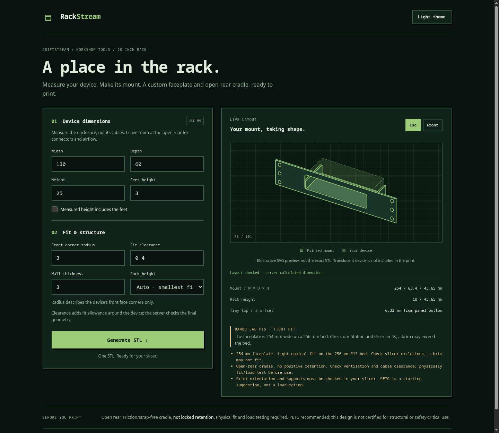

# RackStream

A small DriftStream web app: enter box-shaped device dimensions, inspect a lightweight SVG preview, and generate a real OpenSCAD-rendered STL download. No account, database, cloud service, JavaScript framework or CDN.

## Screenshots



See the [screenshot gallery](docs/screenshots.md) for the light-theme front view, automatic 3U sizing and mobile layout. These are captures of the running app, not mock-ups; the in-app drawing is an illustrative SVG, not an exact STL render.

## Make your first mount

1. Measure the device's **width, depth and body height** in millimetres. Enter the feet height separately. If your height measurement already includes the feet, select **Measured height includes the feet**.
2. Set the **front corner radius** to match the enclosure; use zero for square corners. The radius applies to the front face, not the footprint.
3. Start with **0.4 mm per-side clearance** and **3 mm wall thickness**, then adjust to suit your printer, material and fit tests. Leave **Rack height** on **Auto** to choose the smallest valid 1–3U mount, or force a particular height.
4. Inspect the **Iso** and **Front** previews, the calculated dimensions and the printer warnings. The visible body is centred while the tray sits below its feet. Invalid dimensions disable generation and show an explanation.
5. Click **Generate STL ↓**. The server renders the mount with OpenSCAD and the browser downloads it. Open the file in your slicer, choose orientation/supports and check the P1S bed limits before printing.

The reference device is **not** included in the STL. This version is an open-rear cradle, not a locking enclosure. See the [printing limits and safety notes](#printing-limits--safety) before using it with equipment.

## Run

Python 3.11+ and OpenSCAD 2021.01+ are required. Create the venv on a local filesystem, not the Samba project share.

```sh
git clone git@github.com:deanralph/RackStream.git
cd RackStream
python3 -m venv ~/.venvs/RackStream
~/.venvs/RackStream/bin/python -m pip install -r requirements.txt
# Install OpenSCAD with your OS package manager, or set OPENSCAD_BIN to its executable.
QT_QPA_PLATFORM=offscreen ~/.venvs/RackStream/bin/waitress-serve --listen=127.0.0.1:8324 --threads=4 app:app
```

Open http://127.0.0.1:8324. For trusted LAN access, explicitly change the listen address to `0.0.0.0:8324`. There is no authentication: do not publish this service directly to the internet. Generation is synchronous, capped at two concurrent renders with a 90-second timeout. Requests are limited to 8 KiB. Temporary render files are deleted after each job; `TMPDIR` controls their parent directory.

On the development machine, a user-local extracted official OpenSCAD AppImage lives under `~/.local/opt/openscad/`; the app detects it if no configured/system executable exists. Its supplemental GL libraries are user-local too: no host packages were installed. A normal OpenSCAD installation is preferred on other machines.

## Inputs and geometry

- All dimensions are mm. Width is left-to-right, depth front-to-rear, height bottom-to-top.
- Height normally means the body alone. Select **height includes feet** when that is what you measured; the engine subtracts feet exactly once.
- Body centring is visual: the body midpoint, not the combined feet/body envelope, is centred in the panel. Tray top is body bottom minus feet height; tray bottom is another wall thickness below.
- Radius describes the front-face corners only, not a rounded footprint. Radius may not exceed half the smaller body dimension. The aperture adds the per-side clearance to width, height and radius.
- Rack profile: front width 254 mm, horizontal hole spacing 236.525 mm, nominal U pitch 44.45 mm. Physical panel is 0.8 mm shorter than its nominal U envelope, centred in that envelope. Hole centres use the repeating 6.35 / 22.225 / 38.1 mm offsets, adjusted by 0.4 mm for the shortened panel. Holes are 7 mm round through-holes.
- Allow 222.25 mm nominal clear rail opening, with 1 mm margin on each side: device + clearance + side rails must not exceed 220.25 mm. **Measure your actual rack**; this first version does not support rack-profile overrides.
- Auto picks the smallest of 1–3U that accommodates body-centred placement, feet, tray and panel borders. A forced height fails explicitly if it cannot fit.
- Solid shelf and two side rails, open rear; device inserts from behind and sits behind the front panel. No rear latch, straps, foot pockets or positive retention in v1. Feet are a height allowance, not a guessed location.
- Device in the SVG is a reference only: it is not included in the STL. Preview is an illustration, not an interactive mesh viewer or structural simulation. The server provides all fit calculations used by both preview and renderer.

## Printing limits / safety

Default printer: Bambu Lab P1S, nominal 256 × 256 × 256 mm. This version conservatively reserves a 254 mm XY working envelope, in the supplied rack-coordinate orientation. The 254 mm panel has almost no room for a brim. Inspect slicer exclusion zones, orientation, adhesion, overhangs and supports. Other orientations are possible but are not automatically searched. Oversize models are rejected, not scaled or split.

The STL is in rack coordinates, not auto-oriented for support-free printing. Choose orientation and support settings in your slicer. Printing faceplate-down may be useful, but test adhesion and resulting layer strength. PETG is only a starting material suggestion, not a load rating. Check device cooling and cable access. Printed plastic can creep under heat/load. Test fit and load with inexpensive stand-ins before trusting equipment; deep/heavy devices may need rear support. No strength certification or thermal guarantee is implied.

## Verification

```sh
~/.venvs/RackStream/bin/python -m pip install -r requirements-dev.txt
~/.venvs/RackStream/bin/python -m pytest -q
node --test tests/frontend.test.mjs
~/.venvs/RackStream/bin/ruff check .
~/.venvs/RackStream/bin/ruff format --check .
~/.venvs/RackStream/bin/pylint app.py rackstream.py
```

Python integration tests run the actual OpenSCAD executable, load generated 1/2/3U STLs with trimesh, and check watertightness, positive volume, connectedness and dimensions. No fabricated renderer output is used.

## API

`POST /api/preview` accepts a JSON object containing `width`, `depth`, `height`, `feet`, `radius`, `clearance`, `wall`, `units` (`auto`, `1`, `2`, `3`), and `height_includes_feet` (boolean). Returns calculated geometry and advisories. `POST /api/generate` accepts the same input and returns a `model/stl` attachment, or a JSON error. Invalid geometry is HTTP 400; busy or failed rendering is HTTP 503. `GET /health` is a small server health marker, not proof the renderer is installed.
