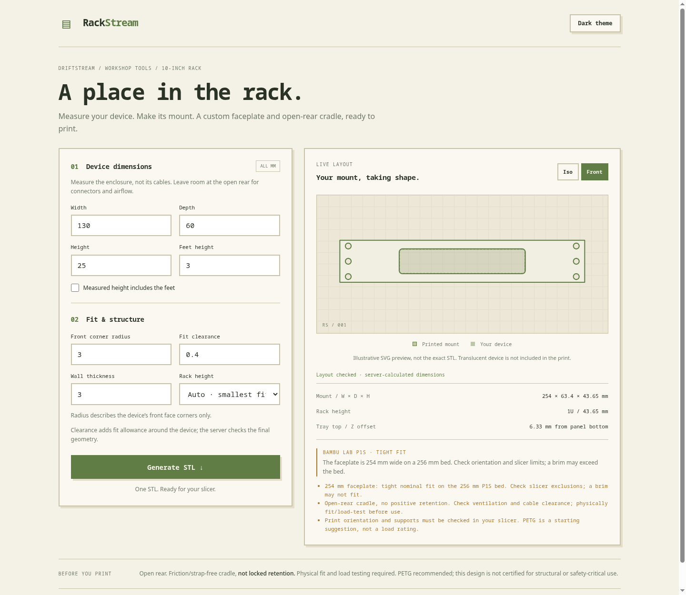
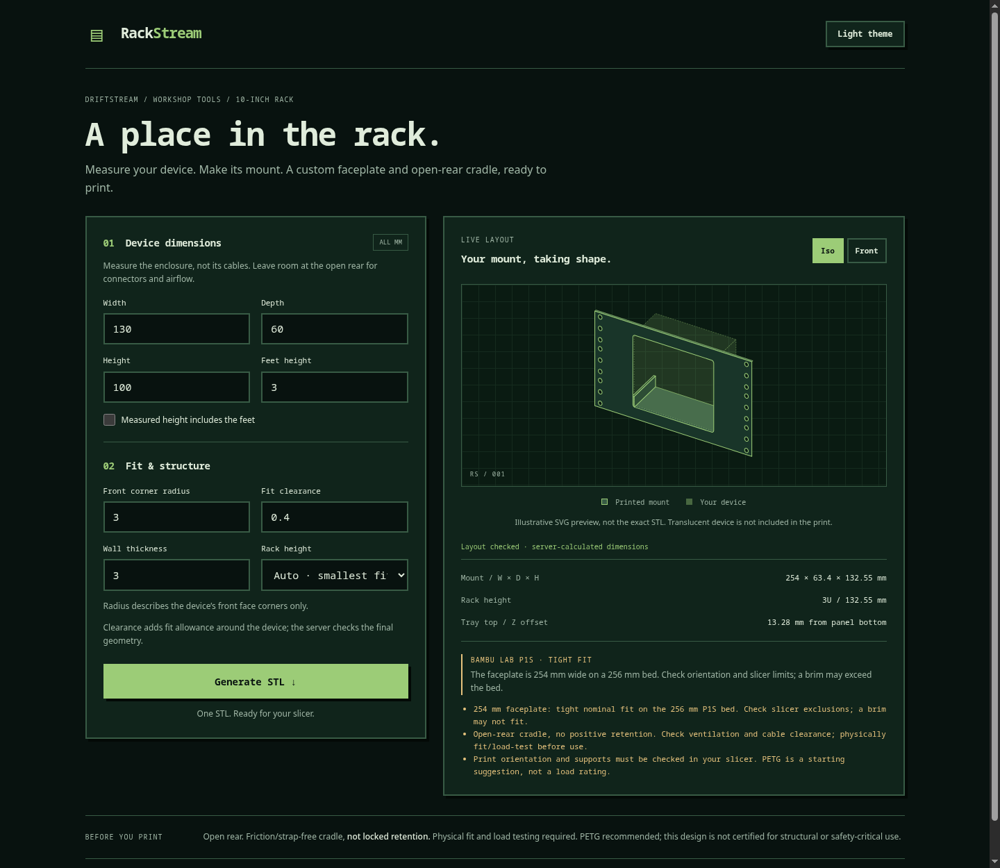
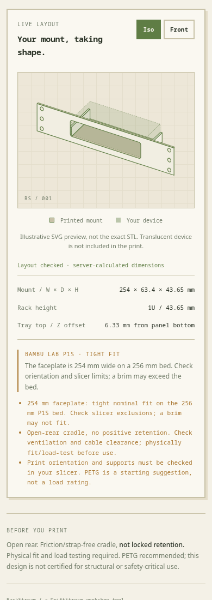

# RackStream screenshot gallery

[← Back to the README](../README.md)

These screenshots show the running app. The mount drawing is a lightweight, illustrative SVG driven by the server's fit calculations; it is not an exact STL rendering. The translucent device is a reference and is never included in the downloaded print.

## Desktop: dimension form and isometric preview

The default example is a **130 × 60 × 25 mm body with 3 mm feet**, a 3 mm front-face corner radius, 0.4 mm per-side clearance and 3 mm walls. Automatic sizing chooses **1U**. The calculated tray position accounts for the feet while centring the visible body.

## Desktop: light theme and front view

Switch to **Front** to inspect the faceplate and opening head-on. The theme toggle switches between DriftStream's dark green and light cream palettes, and remembers the choice.

## Automatic multi-U sizing

Increasing the body height to **100 mm**, with the other default measurements unchanged, selects **3U** automatically. The faceplate, aperture, rack-hole pattern and tray position update together. The calculated physical panel height is **132.55 mm**, allowing clearance within the nominal 3U envelope.

## Mobile: preview and fit summary

On a narrow screen the form and preview stack vertically. This capture is scrolled to the preview, showing the view controls, calculated dimensions and P1S warnings without horizontal overflow.

## Capture notes

- Desktop viewport: **1440 × 1250 px**.
- Mobile viewport: **390 × 1100 px**.
- Captured from the local app after the server approved each displayed layout.
- No device names, account details or browser address bars are included.
- Nominal bed fit is not a guarantee of slicer compatibility, physical fit or load capacity. Read the README's printing notes and test before mounting equipment.
